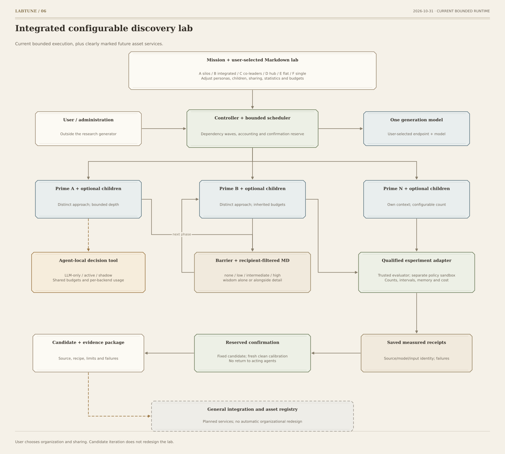

# Architecture and implementation scope

The user supplies a mission and chooses a Markdown lab design. Configuration resolves
personas, phases, sharing, statistics and budgets. Ready dependency waves can run concurrently;
actor contexts remain separate and child agents inherit or narrow their parent's permissions.
A phase barrier precedes peer publication. Design F instead runs one scientist's selected
passes and sequences in order, with continued context by default and one shared budget.

Generation uses a user-configured chat-completions endpoint. Optional semantic judgments use
the same generation model or a separately declared chat/typed endpoint. Shadow opinions remain
outside acting contexts. Valid answers resume the same episode, while fallbacks and failures
consume the same budget. Endpoint and model bindings enter configuration identities.

| Layer | Implemented | Limits |
|---|---|---|
| Structural core | Six designs, schemas, strict YAML, dependency graphs, configuration identities | Describes broader planned interfaces too |
| Study runner | Explicit provider calls, bounded concurrency/delegation, JSON correction, filtered sharing | Settings change between runs |
| Domain tools | Registered qualified adapters and synthetic memory-policy execution | Candidate execution requires native macOS sandbox qualification |
| Evaluator | Separate calibration, development and confirmation panels, uncertainty and costs | Synthetic finite-horizon evidence |
| Comparison | Saved metrics, denominators, failures and compute filtered by study identity | No automatic winner or style ranking |
| Asset lifecycle | Schemas and design contracts | General registry and integration are planned |

The package ships its own starter resources. Initialization generates private seed panels
locally. Trusted evaluators own labels and future inputs; candidate source runs only in a
separate sandboxed interpreter. Confirmation occurs after development and never returns to
the acting agents. [Execution boundaries](SECURITY.md).

Two local, read-only visualization agents project the exact setup and observe filtered runtime
metadata. The viewer distinguishes execution from evidence and live activity from stale or
recorded observations. It exposes no prompts, generated code, private seeds or research results.
See [visualization](docs/VISUALIZATION.md) and [current scope](docs/SKELETON.md).
