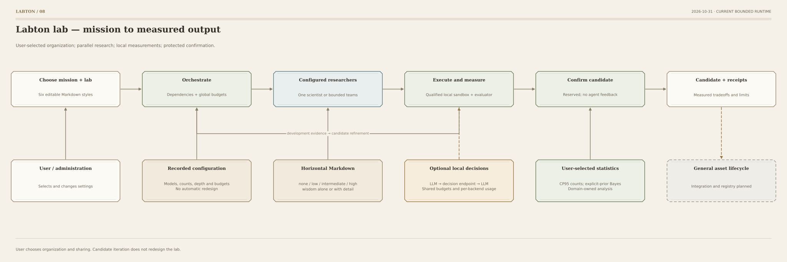

# Labton — configurable discovery labs

Labton runs bounded research workflows with a user-selected organization, models,
communication rules and budgets. Choose one scientist or several complementary agents,
inspect the process, and retain outputs alongside the evidence needed to assess them.

**Author:** Goran Mitevski. **Copyright holder and licensor:** Pioneertown B.V.

## Start without a model account

Python 3.11+ is required. From the repository root:

```bash
python3 -m pip install -e .
labton init ../my-lab
cd ../my-lab
python3 lab.py prepare
```

Setup and planning make no provider calls. Starters contain placeholder URLs and model IDs;
choose your service and credentials explicitly in study.yaml before a live run.
[Getting started](docs/GETTING_STARTED.md) and [provider configuration](docs/PROVIDERS.md)
explain the generation and optional decision protocols. No service account is bundled or preferred.
See [0.2.0 release notes](docs/RELEASE.md) when updating an existing workspace.

## Choose the lab

| Design | Organization |
|---|---|
| A | Multidisciplinary silos |
| B | Transdisciplinary integration |
| C | Complementary co-leaders |
| D | Hub-and-spoke matrix |
| E | Flat / holacratic co-lab |
| F | Single scientist |

[Markdown designs](lab_designs/README.md) supply editable personas and phases. The user chooses
counts, delegation, concurrency, sharing and statistical methods. There is no automated lab redesign.

The [single scientist](docs/SINGLE_SCIENTIST.md) supports low, medium and persistent effort:
1, 3 or 6 passes per sequence, or persistent work until a budget allowance. Choose the sequence
count; sequences continue the same context by default and share one overall budget.

```bash
labton init ../scientist-lab --template scientist
```

## Watch the process

Run python3 lab.py visualize --variant single in a text workspace and open its printed local URL.
A setup visualizer and runtime observer show the selected process and current computation.
These local, read-only agents make no model calls. The interface supports saved runs, offline
HTML snapshots, Team view, zoom and node inspection. [Visualization guide](docs/VISUALIZATION.md).



## Execute a measured example

The [synthetic memory-retention task](examples/memory_retention/README.md) includes an independent
generator, bounded policy API, trusted evaluator and separate development/confirmation panels.
Candidate execution requires native macOS sandbox qualification. Text workflows produce
unevaluated proposals; they do not establish scientific correctness.

```bash
python3 -m pip install -e '.[memory]'
labton init ../memory-lab --template memory
```

One generation model can fill every role. Optional decisions use the same model or a separate
configured endpoint, with LLM-only, shadow and selected-active modes. Other API protocols need
an adapter; changing a URL alone does not translate a protocol. [Decision configuration](docs/DECISION_PROVIDERS.md).

## Scope and evidence

The runner implements dependency-wave scheduling, bounded child agents, filtered Markdown
sharing, provider accounting and registered domain tools. General asset integration, durable
scheduler recovery, live reconfiguration and unrestricted candidate execution remain outside
this release. No benchmark winner or automatic quality improvement is claimed.

See [architecture](ARCHITECTURE.md), [current scope](docs/SKELETON.md), [flow diagrams](FLOWCHARTS.md),
[execution boundaries](SECURITY.md) and [contributing](CONTRIBUTING.md).

Labton is free to use, modify and share for **noncommercial academic research at qualifying
public or nonprofit educational institutions** under the [Labton Academic Research License 1.0](LICENSE).
Company labs, corporate research proxies and commissioned commercial research are excluded.
Company support is allowed only as a genuinely unrestricted donation without control or privileged
research or IP rights. Other use requires separate written permission. See [licensing](LICENSING.md).
