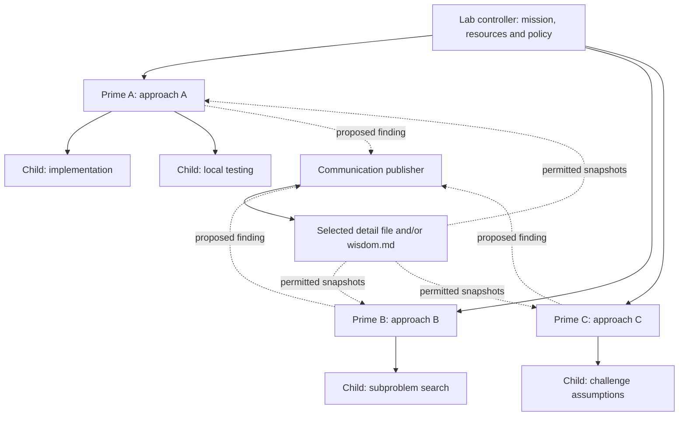

# Adjustable agent teams and horizontal communication

Status: configuration resolves sharing rules; the bounded runner publishes filtered Markdown
at dependency barriers. General rich communication services remain outside this release.

The lab can have several **prime agents**, each pursuing a distinct approach to the same mission. A prime can delegate to child
agents, subject to configurable depth, concurrency, tools, and inherited budgets. All agents
can use the same configured LLM. A configured decision model remains optional.

See the [integrated lab flowchart](LAB_FLOW.md) for this communication design in the whole system.

Prime and child agents can also invoke the [decision tool](decision_tools.md) inside their own
work loops. Those calls inherit the same sharing permissions and budgets. A specialist sees
only caller-visible context and cannot expose hidden peer results or wisdom through its answer.

## 1. Configurable controls

| Control | What is adjustable |
|---|---|
| Lab design | Selected Markdown preset, research personas, governance and collaboration procedures |
| Approach portfolio | Prime-agent count, approaches, starting artifacts, model assignments, and budgets |
| Team structure | Child count, recursion depth, active descendants, role assignments, and allowed tools |
| Horizontal sharing | Detail level, wisdom on/off, peers, cadence, read budget, and delivery timing |

An approach is more specific than a persona: a different algorithm, representation, decomposition,
assumption, or intervention. Prime agents remain responsible for proposing and testing their
own approaches. Child agents can implement a component, investigate a subproblem, run diagnostics,
or challenge a local explanation.

Prime depth is 0; its children have depth 1. A maximum depth of 0 disables delegation; a maximum
depth of 2 permits grandchildren. Configure limits per mission and override them per prime.
Every descendant consumes its prime's allocation and the lab's global allocation. Spawning
does not create extra budget. Limit total active agents, LLM requests, and execution jobs separately.

For example, three primes may each permit two children while a global cap allows only six
agents to be active at once. Excess work queues; the declared topology does not override capacity.
Waiting parents must yield execution capacity where needed so the scheduler can run their children.



The publisher is a controller-owned service. It handles transport and policy; the exchange is
horizontal because its content comes from peer prime teams rather than central research orders.

## 2. Five named modes, plus wisdom combinations

The user listed four detail levels and a separate wisdom channel. We treat **wisdom-only** as
the fifth named mode. Internally, use two settings: `detail` and `wisdom.enabled`.

| Named mode | Detail | Wisdom | Horizontal files read by a prime |
|---|---|---|---|
| `none` | none | off | None |
| `low` | low | off | [low.md](templates/communication/low.md) |
| `intermediate` | intermediate | off | [intermediate.md](templates/communication/intermediate.md) |
| `high` | high | off | [high.md](templates/communication/high.md) |
| `wisdom_only` | none | on | [wisdom.md](templates/communication/wisdom.md) |

Wisdom can additionally be enabled alongside low, intermediate, or high. That gives eight useful
configurations: the five named modes plus the three detail-and-wisdom combinations. Detail none
with wisdom enabled is wisdom-only, not no communication.

Each detail level selects one file. Low-mode readers do not receive intermediate or high files.
Use templates in [templates/communication](templates/communication/low.md); they are empty formats,
not recorded findings. Policy resolution is implemented; runtime publication and enforcement
remain future components.

### None — preserve independent search

**Why:** establish the benefit of independent approaches and a baseline for the cost and value
of communication.

**How:** no peer notes, wisdom, peer artifacts, live peer scores, comparative rankings, or
peer-derived suggestions enter an agent's context. Primes may still communicate vertically
within their teams and submit results to the controller. The controller retains private evidence
for evaluation without redistributing it to search workers.

Give primes the same declared initial knowledge snapshot and a fixed initial comparator. A
continually broadcast incumbent would be a communication channel. Shared infrastructure and
resource scheduling remain, so this setting does not claim mathematical independence of agents.
Scheduler messages should contain operational facts, not indirect hints about another method.

### Low — only notable, evidenced dead ends

**Why:** reduce expensive repetition while preserving freedom to find different successful methods.

**How:** publish a small selection of costly or reproducible failures with the tested conditions,
observed limitation, exceptions, and evidence IDs. Notability thresholds are configurable.
Do not include winning approaches, positive-result rankings, exact recipes, or recommendations
about what another agent should build next.

Distinguish an implementation failure from a method failing its intended test. A failed attempt
is not a universal prohibition; a prime may revisit it when assumptions or conditions differ.

### Intermediate — compact findings and broad method information

**Why:** share useful positive and negative results while limiting solution copying.

**How:** include notable dead ends, observed constraints, coarse method descriptions, and concise
positive findings or tradeoffs. Declare the conditions and evidence. Exact winning code, detailed
tuning recipes, and full traces remain outside this channel.

This mode can influence direction more than low communication. That is an explicit experimental
choice, not a promise that agents remain unanchored.

### High — detailed exchange

**Why:** allow deliberate collaboration, reuse, recombination, and rapid follow-up.

**How:** include experiment summaries, measured values, methods, tested parameters, artifact
references, reproducible failures, and clearly marked unresolved hypotheses. Referenced artifacts
must be separately permitted; a link is not automatic access to every peer workspace.

High communication is still bounded by context, read frequency, and total cost. It does not
require unlimited chat or raw transcript sharing. Frozen confirmation material remains protected
in every mode.

### Wisdom-only — conditional abstractions without detailed results

**Why:** let teams benefit from general lessons while reducing direct solution steering.

**How:** publish only the abstract channel described below. Do not expose low, intermediate,
high, or their underlying peer artifacts through a back door.

## 3. What belongs in wisdom.md

Wisdom is a small collection of conditional observations about problem structure, testing,
failure mechanisms, or useful distinctions. It is not a leaderboard, a central strategy, or
a compressed copy of the winning implementation.

Each entry records:

- **Principle:** the abstraction suggested by observed evidence.
- **Applies when:** the conditions under which it may be useful.
- **Limits and exceptions:** where it failed, remains uncertain, or has not been tested.
- **Evidence status:** tentative, repeated within a scope, contradicted, or superseded.
- **Evidence IDs and revision:** traceability without automatically exposing detailed artifacts.

Illustration of wording, **not a finding established by this lab**:

> When an intervention changes work per iteration, a fixed iteration count may compare unequal
> resource use. The relevance of this distinction depends on the mission's resource constraint.

This leaves the other team free to choose its own method. An entry such as "Agent A's technique
is best; use its initializer and these parameters" belongs outside wisdom.

Reduce steering by omitting prime identities, rankings, exact successful parameters, implementation
recipes, and proposed next actions from the reader-facing wisdom file. Keep detailed attribution
and evidence mapping in the controller's record. Evidence IDs do not grant artifact access.

Do not remove caveats merely to make an entry sound general. A single observation can be recorded
as tentative; it must not become a proven rule through summarization. Include conflicting
observations and revise or withdraw stale principles. Preserve useful conditions rather than
making the abstraction so vague that it conveys nothing.

An LLM curator using the same configured model can draft abstractions from eligible findings.
a configured decision model can optionally screen relevance or policy fit. The controller
checks source references, allowed fields, size, and publication policy. No model can guarantee
that an abstraction will not steer a reader; this is an effect to measure.

Scope wisdom per mission or problem family by default. Lab-wide wisdom is a separately configured
knowledge source. It must not silently transmit current peer results into an isolated mission.

## 4. Keep Markdown exchange controlled and reproducible

### Publication

Each prime writes proposed findings into its own outbox. The publisher applies the selected
policy and emits immutable versions of the shared Markdown. Workers do not concurrently append
to a common file. The event store remains authoritative; Markdown is the actual exchange view
supplied to agents, with source records and hashes retained for replay.

Suggested run layout:

```text
mission/
  teams/
    prime_a/outbox/findings.md
    prime_b/outbox/findings.md
    prime_c/outbox/findings.md
  communication/
    records/                    controller-owned source records
    snapshots/000001/
      low.md                    selected detail view when applicable
      intermediate.md           selected detail view when applicable
      high.md                   selected detail view when applicable
      wisdom.md                 only when enabled
    reads/                      recipient, snapshot, entries, time and context cost
```

The layout shows possible files, not a requirement to generate or expose every detail view.
An agent receives only its permitted snapshot files. Private source records and other teams'
outboxes remain inaccessible. Low access cannot be upgraded by following a high-detail link.

### Delivery and reading

Begin with checkpoint delivery at an episode boundary. Cadence, triggers, maximum entries,
word budget, and deduplication policy are adjustable independently of detail level. High detail
can be infrequent; low detail can be frequent.

An optional diversity measure requires each prime to commit its initial approach before the
first horizontal read. Agents receive knowledge, not a command to abandon their approach.
Record which snapshot and entries actually entered each agent's context; file availability
alone is not evidence that an agent read it. Include curation and reading costs in lab usage.

### Scope and children

Horizontal exchange is between prime teams. Child findings return to their parent; the parent
can propose them for publication. Children inherit their prime's horizontal permissions and
cannot independently read a richer channel, contact another team, or publish around the policy.
The parent may supply a relevant subset of its permitted snapshot to a child.

Vertical delegation has a separate policy and can be rich even when horizontal sharing is off.
The first runtime implementation can use one current horizontal profile per mission, editable
by the user at recorded boundaries. Per-prime or directed peer-group overrides can be added
through recipient-specific views; a globally readable Markdown file cannot enforce different
permissions for different readers.

Changing policy does not erase information already read. To compare communication settings,
start fresh teams from the declared initial snapshot. Mid-run changes retain their exposure
history and must not be labeled independent no-communication runs.

Shared prompts, workflows, playbooks, and caches can transmit peer findings without a shared
Markdown read. Preserve source/access lineage under the current policy. The user may change
settings; record when the change takes effect and retain prior exposure. For clean comparisons,
the user can choose matched initial knowledge and fresh contexts. See the
[evidence and comparison notes](learning_and_evaluation.md).

Retain rich evidence and operational playbooks behind the horizontal views. Update wisdom in
small versioned entries with support and contradiction references rather than repeatedly
rewriting all retained knowledge into an abstract summary. Agent-reported usefulness and actual
checked reuse outcomes are distinct signals; neither endorsement count alone establishes truth.

### Lab styles, meetings, and other Markdown forms

[Lab-design presets](lab_designs/README.md) suggest sharing and coordination patterns; the user's
explicit settings override those suggestions. Meetings, proposal boards, framework workshops,
paired challenges, and handoffs are optional mechanisms under the same content policy. They
cannot transmit richer information than the selected level or bypass a none/wisdom-only boundary.

Use bounded asynchronous turns, an agenda, input snapshot, resource limit, rotating or assigned
facilitator, and an explicit disposition. Keep raw records private; publish recipient-appropriate
views. Under none, only operational coordination remains active. Low meetings are failure-focused;
wisdom-only meetings exchange conditional abstractions. Full research co-design is limited or
inactive when its information requirements exceed the user's cap, and that variant is recorded.

A hub leader with broader review access still cannot relay hidden peer knowledge to a restricted
recipient. Flat peer governance does not remove the code controller or evidence checks. See the
[preset catalogue](lab_designs/README.md) for forms, examples, and override behavior.

## 5. Skeleton configuration

These fields are accepted by the current loader. They describe the future runtime policy;
planning does not launch agents or exchange files. No setting is claimed to be optimal.

```yaml
schema_version: 1
model:
  provider: unconfigured
  name: unconfigured
resources:
  max_active_agents: 6
  max_llm_requests: 3
  max_experiments: 2
teams:
  max_depth: 1                  # prime = 0; child = 1
  max_children_per_agent: 2
  max_active_descendants: 2
communication:
  profile: low                 # preset | none | low | intermediate | high | wisdom_only
  wisdom: true                 # with none this resolves to wisdom_only
  cadence: episode_boundary
  max_read_words: 700           # combined budget for detail + wisdom
decisions:
  mode: llm_only
```

For strict no communication, set `profile: none` and `wisdom: false`. All models can resolve
to the single configured LLM; per-agent overrides are an optional extension. Children share
their prime's finite mission allocation, including tool, evaluation, communication, and model
costs. Verification has its own protected allocation. Per-role models, per-team overrides,
and directed sharing policies remain extension contracts rather than accepted config fields.
See [configs/README.md](configs/README.md) for the current schema and override precedence.

## 6. Later: how to compare these ideas

Use the five named modes and the three wisdom combinations as experiment conditions. Hold
initial tasks, approach assignments, model, total resources, and confirmation protocol fixed.
Test hierarchy/delegation separately before claiming an effect from communication.

Measure verified useful improvements, elapsed time, total resource cost, duplicate experiments,
communication overhead, reproducibility, and the range of mechanisms actually tested. Record
whether a prime abandons an approach after reading a peer note and whether that choice helps.
Estimated compute "saved" by a note is a hypothesis unless a controlled comparison supports it.

Specific questions:

- Does low communication eliminate repeated costly dead ends without reducing useful exploration?
- Does wisdom-only transfer useful structure while preserving distinct methods?
- Does adding wisdom help low/intermediate/high sharing, or merely duplicate their content?
- Does detailed sharing accelerate reuse while narrowing the approaches tested?
- When does deeper delegation add useful work rather than coordination overhead?

These are hypotheses. Communication that helps one mission may hurt another. Keep the settings
observable and reproducible so the lab can learn when each arrangement is useful.
